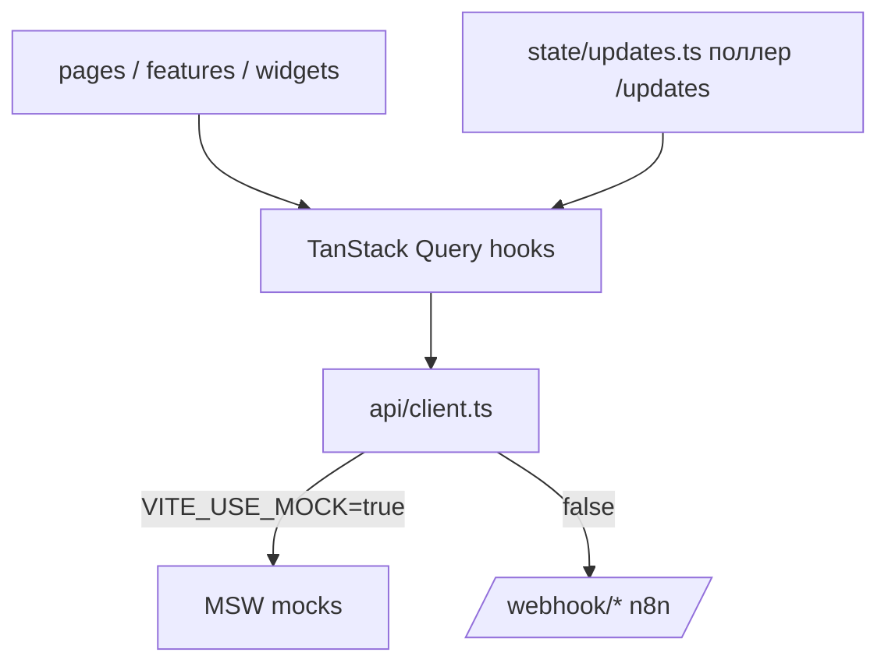

# 02_ARCHITECTURE_FE — архитектура фронтенда

Версия 1.0 · 20.11.2026. Стек — рекомендация (01_README_AGENT §3).

## 1. Структура репозитория
```
/ (корень репо)
  docs/            PROGRESS.md, DECISIONS.md, QUESTIONS.md, CONTRACT_REQUESTS.md, MOCK_SCENARIOS.md
  contract/        03_API_CONTRACT.yaml (копия из пакета; источник правды)
  src/
    api/           client.ts (fetch, базовый URL, токен, ошибки), endpoints/*.ts, types.gen.ts (из OpenAPI)
    mocks/         seed.ts, handlers.ts, engine.ts (команды/сценарии), DebugPanel.tsx
    app/           router.tsx, layout/ (Shell, SideNav, BottomNav, TopBar, AlarmBanner)
    pages/         Login, Overview, Object, Post, Actuator, Alarms, Charts, Rules, Schedules, Audit, Settings/*
    widgets/       Gauge, Lamp, Card, Chart, Bar, Table, Map, Scene3D, Soil3D, WidgetFrame
    features/      commands/ (CommandButton, ConfirmDialog, StatusTrail), bindings/, dashboard-builder/, alarms/
    state/         session.ts (токен), ui.ts (тема, выбранный объект), updates.ts (поллер)
    lib/           time.ts (пояс объекта), quality.ts, format.ts, tagId.ts
    i18n/          ru.ts
    styles/        tokens.css, global.css
    assets/brand/  logo.svg, brand.json
  public/          manifest, иконки PWA
```

## 2. Слои

- Компоненты не вызывают fetch напрямую — только хуки `useXxx()` из `src/api/endpoints`.
- Типы ответов генерируются из `contract/03_API_CONTRACT.yaml` (`npm run gen:api`). Ручное описание типов API запрещено.

## 3. Обновление данных
- Один глобальный поллер `/updates?since=` : 30 с по умолчанию; 5 с, пока есть команда в статусах created/awaiting_confirm/queued/sent_gw; пауза, когда вкладка скрыта (visibilitychange).
- Ответ раскладывается в кэш Query (`setQueryData`) по сущностям: tags, commands, alarms, actuators, modems. Полные списки перезапрашиваются только при входе на страницу.
- Ошибка сети — баннер «Нет связи с сервером, данные на HH:MM», повтор с backoff 5→60 с.

## 4. Авторизация
- Токен в памяти + sessionStorage (не localStorage). 401 → очистка, переход на /login с возвратом на исходный путь.
- Logout — POST /auth/logout и очистка кэша.

## 5. Маршруты (base `/dash/`)
`/login`, `/` (обзор), `/o/:objectId` (дашборд/3D), `/o/:objectId/p/:postId`, `/a/:actuatorId`, `/alarms`, `/charts`, `/rules`, `/schedules`, `/audit`, `/settings/{objects|onboarding|bindings|commands|alarms|chains|sources|sim}`.

## 6. Сборка и окружения
| Переменная | dev | prod |
|---|---|---|
| VITE_USE_MOCK | true | false |
| VITE_API_BASE | /webhook | /webhook |
| VITE_BASE_PATH | / | /dash/ |
Команды: `dev`, `build`, `preview`, `lint`, `test`, `e2e`, `gen:api`. Прод-артефакт — `dist/`, раздаётся Caddy по `/dash/*` (SPA fallback на `/dash/index.html`).

## 7. Производительность
- Code-split по страницам; 3D (three.js) и ECharts грузятся лениво.
- Бандл начальной страницы ≤ 300 КБ gzip.
- Графики: при > 5000 точек — запрашивать агрегат (step 1h/1d).

## 8. Ошибки API
Единый обработчик: код из `error.code` → текст из `i18n/ru.ts` (напр. DURATION_OVER_MAX → «Длительность больше допустимой: максимум {max}»). Неизвестный код — показать `message`.
